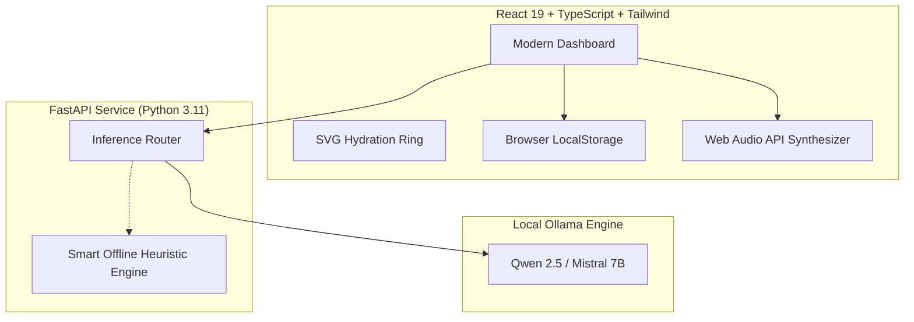

## The Silent Problem: Deep Work and Chronic Dehydration

Whether you are debugging a distributed system at 2 AM, prepping for an exam, or running remote sprints, cognitive absorption has a familiar cost: **you forget to drink water**.

Most hydration apps available on mobile stores suffer from two major problems:
1. **Hostile Nagging:** Rigid timers interrupt calls and meetings, eventually annoying the user into disabling notifications altogether.
2. **Privacy Violations:** Intimate daily routines (wake time, sleep hours, fluid intake) are transmitted to remote servers, aggregated, and fed into analytics platforms.
3. **Aggressive Paywalls:** Simple reminders often demand \$4.99/month subscriptions simply to deliver generic notifications.

To solve this, we built **[HydrateAI](https://github.com/hydrateai/hydrateai)** — a local-first, open-source hydration assistant powered by **open-weight AI models** running directly on your machine via **Ollama**.

---

## Why Open-Source AI is the Real Hero

When handling personal wellness routines, **privacy is non-negotiable**. HydrateAI was designed from the ground up around open-source AI:

### 1. Zero Cloud Ingestion
All prompt crafting and text generation take place locally via Ollama (`http://localhost:11434`). Your sleep schedule, daily targets, and drink timestamps never leave your machine.

### 2. Transparent, Verified Licenses
Instead of proprietary black-box APIs, HydrateAI integrates models with verified open-source and open-weights licensing:
- **Qwen 2.5 3B / 7B** — Apache 2.0 License
- **Mistral 7B Instruct** — Apache 2.0 License
- **Llama 3.2 3B** — Llama 3.2 Community License

### 3. Interchangeability Without Rebuilding
You don't need to rebuild or redeploy anything to switch models. Select your installed model right from the dashboard UI.

### 4. High-Availability Failsafe
What happens if you're on a flight or don't have Ollama running? HydrateAI includes a built-in heuristic fallback engine. The core tracking, interval chimes, and reminders continue working flawlessly offline.

---

## Architecture Overview

HydrateAI keeps its architecture clean, modular, and maintainable:

### Tech Stack Choices:
- **Frontend:** React 19, TypeScript, Tailwind CSS v4, Lucide Icons, Canvas-Confetti
- **Backend:** FastAPI, Uvicorn, HTTPX, Pydantic, Pytest
- **Inference Runtime:** Ollama
- **Audio & Alerts:** Web Audio API (procedural sine wave chime) + Browser Notifications API

---

## Local AI vs Cloud APIs: The Honest Trade-offs

| Factor | Local Open-Weight (HydrateAI) | Closed Hosted API (OpenAI / Claude) |
| :--- | :--- | :--- |
| **Data Privacy** | 🟢 100% on-device, zero telemetry | 🔴 Personal health habits uploaded to cloud |
| **API Costs** | 🟢 \$0.00 / month forever | 🔴 Metered token billing & monthly costs |
| **Offline Support** | 🟢 Runs completely offline | 🔴 Breaks without internet connection |
| **Memory Footprint** | 🟡 Uses 2GB–4GB system RAM | 🟢 Minimal client memory |
| **Setup Barrier** | 🟡 Requires 1-time Ollama installation | 🟢 Instant API key paste |

For a personal habit companion, on-device open-weight AI provides the ultimate balance of privacy, cost, and longevity.

---

## Sustainable Monetization & Side Hustle Potential

HydrateAI is completely open source under the MIT License. For developers looking to turn wellness tools into sustainable indie businesses, the codebase is pre-structured with a clear freemium boundary:

- **Free Core (Open Source):** Full tracking, multi-unit conversions (ml, L, oz), local AI coaching, CSV/JSON export, and unlimited history.
- **Commercial Pro Extension Ideas:**
  - Multi-schedule routines (e.g. Workday vs Weekend vs Workout modes)
  - Deep habit correlation (water consistency vs sleep hours)
  - Team / Remote Office Water Guilds for distributed engineering teams

---

## Try It Out & Contribute!

The complete code, automated tests, and installation instructions are live on GitHub:

👉 **[Repository & Setup Instructions](https://github.com/hydrateai/hydrateai)**

We welcome pull requests, new model templates, and feature ideas for Hacktoberfest! Let us know in the comments: *What open-weight model do you prefer running locally on your setup?*
