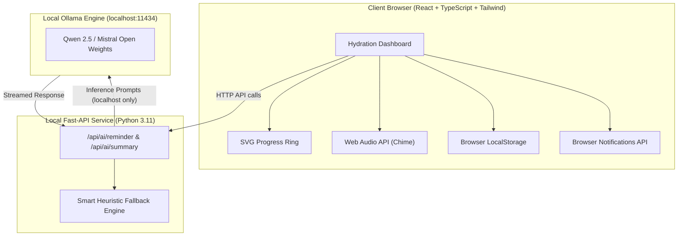

# 💧 HydrateAI — Smart Local-First Hydration Assistant

[](LICENSE)
[-06b6d4.svg)](https://ollama.com)
[](#privacy-guarantee)
[-brightgreen.svg)](#testing)

**HydrateAI** is an open-source, AI-powered water drinking companion engineered to help students, developers, remote workers, and busy professionals build sustainable hydration habits. Built with a **privacy-first, open-weight architecture**, HydrateAI runs language models entirely on your own device through **Ollama**—ensuring zero personal health routines or logs are sent to third-party cloud APIs.

---

## 📑 Table of Contents
1. [The Problem Statement](#the-problem-statement)
2. [Key Features](#key-features)
3. [Why Open-Source AI Matters](#why-open-source-ai-matters)
4. [Supported Open-Weight Models & Licenses](#supported-open-weight-models--licenses)
5. [Local AI vs Hosted Closed AI](#local-ai-vs-hosted-closed-ai-trade-offs)
6. [Architecture Diagram](#system-architecture)
7. [Installation & Setup](#installation--setup)
8. [Running Tests](#running-tests)
9. [Side Hustle & Monetization Concept](#monetization--side-hustle-potential)
10. [Demo Script & Video Instructions](#video-demonstration-script)

---

## 🎯 The Problem Statement

During intense deep-work periods, coding sprints, or study sessions, cognitive fatigue often causes people to forget basic physiological needs—chief among them, drinking water. Common hydration apps suffer from critical flaws:
- Rigid interval timers that annoy users and get quickly uninstalled.
- Shaming streaks that discourage users after missing a day.
- Requirement to register cloud accounts and upload intimate health schedules to monetized ad networks.
- Overpriced recurring subscriptions (\$5-\$10/month) simply to deliver generic notifications.

**HydrateAI** replaces nagging alarms with context-aware, empathetic micro-coaching powered by local AI models, paired with 1-click logging and complete offline resilience.

---

## ✨ Key Features

- **Personalized Hydration Setup:** Custom wake times, bedtimes, quiet sleep windows, and user-defined targets (not clinical prescriptions).
- **Multi-Unit Precision:** Native support for millilitres (`ml`), litres (`L`), and fluid ounces (`fl oz`).
- **Animated SVG Hydration Ring:** Real-time visual progress ring with celebration confetti upon goal completion.
- **Smart Reminders & Web Audio Chimes:** Configurable notification intervals with pleasant synthesized water chimes and automatic quiet hours.
- **1-Click Quick Add & History Management:** Fast presets (+250ml, +500ml, +750ml), inline timestamp editing, and undo/delete for mistaken inputs.
- **Local AI Companion:** Generates warm, non-clinical reminder prompts and daily reflection summaries via Qwen 2.5 or Mistral.
- **Failsafe Offline Fallback:** If Ollama is offline or uninstalled, the app automatically switches to safe, heuristic coaching—the app never breaks!
- **Data Privacy & Portability:** Single-click export to CSV and JSON, zero external trackers, and full local data erasure options.
- **Light & Dark Themes:** Fluid aesthetic inspired by clean water and calm workspaces.

---

## 🤖 Why Open-Source AI Matters

Personal daily habits—such as wake-up hours, sleep patterns, and bodily intake—are sensitive data. In HydrateAI:
1. **Zero Data Leakage:** Health logs and daily summaries remain within your browser (`localStorage`) and local inference runtime (`localhost:11434`).
2. **Zero Cloud Ingestion & Cost:** No OpenAI or Anthropic API billing. Users and self-hosters incur zero recurring API costs.
3. **User Agency & Interchangeability:** Users can switch between open-weight architectures (e.g., Qwen, Mistral, Llama) with a single dropdown click without recompiling the codebase.

---

## 🧠 Supported Open-Weight Models & Licenses

| Model Name | Default Tag | License | Approximate Size | Minimum Hardware |
| :--- | :--- | :--- | :--- | :--- |
| **Qwen 2.5 3B** *(Recommended)* | `qwen2.5:3b` | [Apache 2.0](https://github.com/QwenLM/Qwen2.5) | ~1.9 GB | 4GB RAM / Any Modern CPU / M1+ |
| **Qwen 2.5 7B** | `qwen2.5:7b` | [Apache 2.0](https://github.com/QwenLM/Qwen2.5) | ~4.7 GB | 8GB RAM / Quad-core CPU or 6GB VRAM |
| **Mistral 7B Instruct** | `mistral:7b` | [Apache 2.0](https://mistral.ai) | ~4.1 GB | 8GB-16GB RAM / 6GB+ VRAM |
| **Llama 3.2 3B** | `llama3.2:3b` | [Llama 3.2 Community](https://llama.meta.com) | ~2.0 GB | 4GB RAM / Integrated GPU or CPU |

*Note: All models recommended run comfortably on standard laptops without requiring high-end dedicated GPUs.*

---

## ⚖️ Local AI vs Hosted Closed AI Trade-offs

| Criterion | Local Open-Weight (HydrateAI Default) | Hosted Closed APIs (e.g., OpenAI / Claude) |
| :--- | :--- | :--- |
| **User Privacy** | 🟢 **100% On-Device.** Logs never traverse the public internet. | 🔴 Health habits transmitted and potentially logged by cloud providers. |
| **Recurring Cost** | 🟢 **\$0.00/month.** Free forever for personal & self-hosted use. | 🔴 Usage-based token pricing or monthly API bills. |
| **Offline Reliability** | 🟢 Runs without an internet connection once model is pulled. | 🔴 Completely unusable on flights, train commutes, or spotty Wi-Fi. |
| **Model Transparency** | 🟢 Open weights with verified open-source licenses (Apache 2.0). | 🔴 Proprietary black-box models subject to stealth deprecation. |
| **Initial Setup** | 🟡 Requires installing Ollama (~1-click download). | 🟢 Instant setup via an API key string. |
| **Hardware Overhead** | 🟡 Uses ~2GB–4GB of local system RAM during generation. | 🟢 Negligible client-side memory footprint. |

---

## 🏛 System Architecture



---

## 🚀 Installation & Setup

### Prerequisites
- **Node.js** 18+ (tested on Node v24)
- **Python** 3.10+ (tested on Python 3.11)
- *(Optional for AI)* **Ollama**: [Download from ollama.com](https://ollama.com)

### 1. Clone the repository
```bash
git clone https://github.com/your-username/hydrateai.git
cd hydrateai
```

### 2. Pull your preferred open model (Optional but recommended)
```bash
ollama run qwen2.5:3b
```
*(If Ollama is not installed, HydrateAI continues running seamlessly via its built-in heuristic fallback engine!)*

### 3. Setup and start the Backend
```bash
# In the project directory:
python -m venv venv

# Windows:
.\venv\Scripts\activate
# macOS / Linux:
# source venv/bin/activate

pip install -r requirements.txt
uvicorn backend.main:app --port 8000 --reload
```

### 4. Setup and start the Frontend
```bash
# In a new terminal tab:
npm install
npm run dev
```
Open **`http://localhost:5173`** in your browser.

---

## 🧪 Testing

HydrateAI includes comprehensive unit and integration tests across both the Python AI engine and TypeScript client logic.

### Running Backend Tests (Pytest)
```bash
# Ensure virtual environment is active
pytest backend/test_main.py
```
*Validates API health check, fallback response guarantees, and AI endpoints.*

### Running Frontend Tests (Vitest)
```bash
npm run test
```
*Validates unit conversions (ml ↔ oz ↔ L), awake hour schedule calculations, and safe quiet hours.*

---

## 💼 Monetization & Side Hustle Potential

HydrateAI is designed with an organic freemium path suitable for indie hackers, productivity creators, and wellness micro-SaaS builders:

### 1. Free Tier (Forever Open Source)
- Manual water logging & custom daily goals
- Full multi-unit tracking (ml, L, oz)
- Local open-weight AI integration via Ollama
- Unlimited history & CSV/JSON export
- Browser notifications and custom sound synthesis

### 2. Premium Concept ($3 - $5 one-time or $1.99/mo)
- **Workday vs Weekend Schedules:** Tailored reminders for remote work vs rest days.
- **Deep Habit Analytics:** Correlation insights between sleep times and hydration consistency.
- **Liquid Visual Themes:** Interactive iced tea, cold brew, and sparkling water progress graphics.
- **Team Water Guilds:** Slack/Discord webhooks for friendly remote office hydration challenges without compromising individual health details.

*(Note: In adherence to hackathon integrity, no dummy payment gateways or fake checkout screens are included in the open-source release).*

---

## 🎬 Video Demonstration Script

If preparing a 2-minute project submission video, follow this recommended walkthrough:

1. **[0:00 - 0:25] The Hook:**
   - Introduce yourself and open the dashboard: *"HydrateAI is an open-source, local-first hydration assistant powered by open-weight AI."*
   - Point out the clean UI, date greeting, and the animated SVG hydration ring.

2. **[0:25 - 0:50] Quick Intake & Customization:**
   - Click the preset `+250ml` and `+500ml` buttons. Show the progress ring updating dynamically.
   - Open the custom log input, add an entry with an optional tag like *"Green Tea"*.
   - Demonstrate the Log History: edit an entry inline and show undo/delete.

3. **[0:50 - 1:20] Open-Weight AI & Privacy:**
   - Point out the **HydrateAI Intelligence** card.
   - Click the **Active Model** dropdown to show configured models: `qwen2.5:3b`, `mistral:7b`.
   - Explain: *"All prompt processing happens strictly on localhost via Ollama—no data leaves the machine."*
   - Click **Refresh** to show the real-time AI summary generation.
   - Disconnect or show the graceful offline fallback badge proving high availability.

4. **[1:20 - 1:45] Smart Reminders & Settings:**
   - Click **Test Now** to play the synthesized water chime and trigger browser notification.
   - Open Settings: display wake/bed time settings, unit switching (`oz` / `L`), and CSV/JSON export.

5. **[1:45 - 2:00] Conclusion & Open-Source Impact:**
   - Highlight the MIT License, passing test suites, and open-source contribution opportunities.

---

## 📄 License
HydrateAI is open-source software licensed under the [MIT License](LICENSE).
